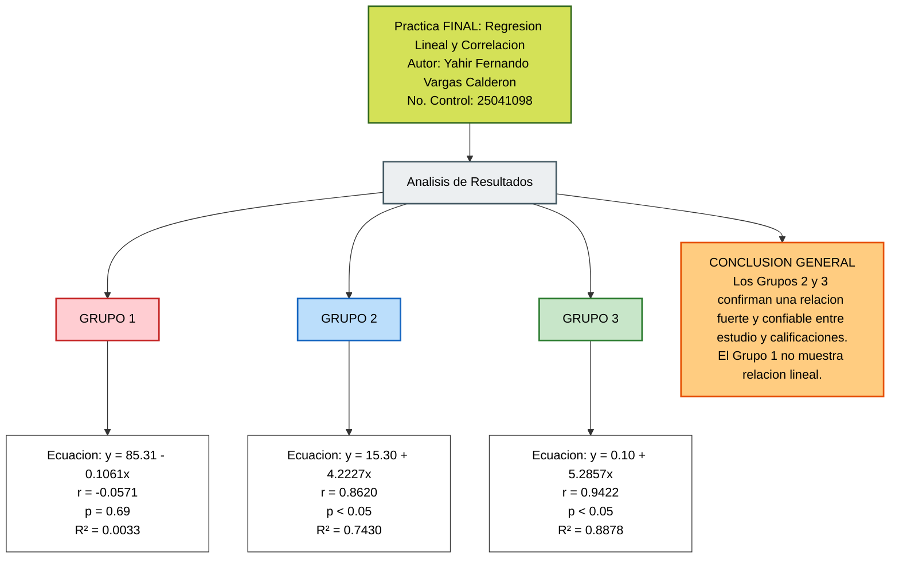
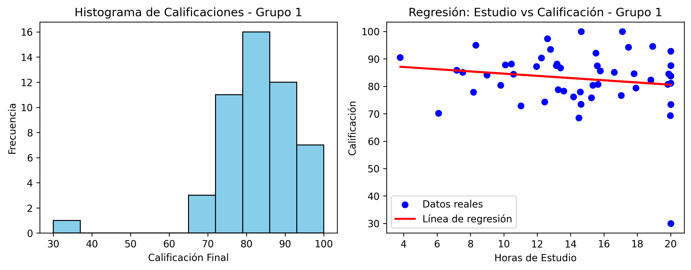
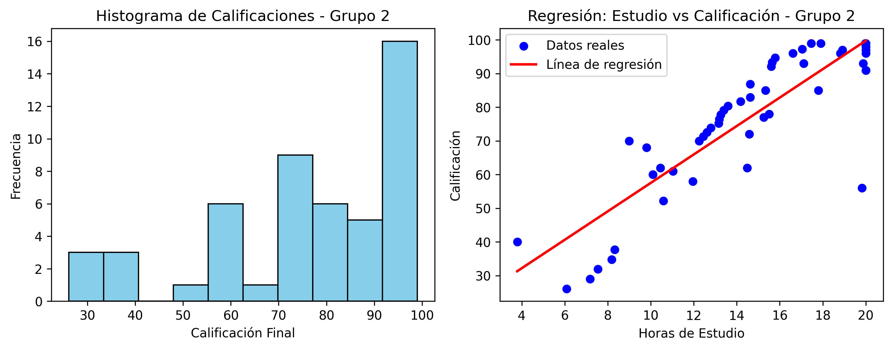
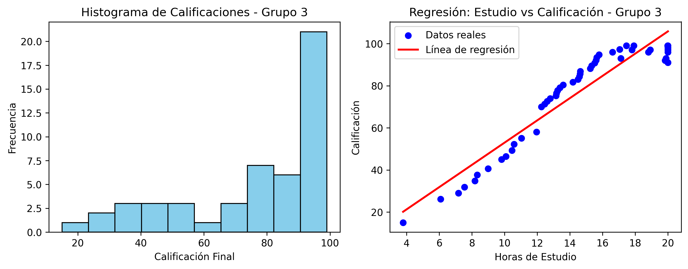

#  Práctica Final: Regresión Lineal y Correlación

| **Información Académica** | **Detalles del Estudiante** |
|:---|:---|
| **Institución:** | Instituto Tecnológico de Durango (ITD) |
| **Carrera:** | Ingeniería en Sistemas Computacionales (3er Semestre) |
| **Materia:** | Probabilidad y Estadística |
| **Docente:** | Dr. José Gabriel Rodríguez Rivas |
| **Alumno:** | Vargas Calderón Yahir Fernando |
| **No. de Control:** | `25041098` |

---

##  Tabla de Contenidos

1. [Introducción y Objetivo](#introduccion)
2. [Metodología y Herramientas](#metodologia)
3. [Diagrama Conceptual del Flujo de Trabajo](#diagrama)
4. [Visualización Gráfica de los Modelos](#graficas)
5. [Conclusión General](#conclusion)
6. [Estructura del Repositorio y Accesos Directos](#repositorio)

---

##  1. Introducción y Objetivo

El presente proyecto tiene como propósito fundamental aplicar los conceptos de **Regresión Lineal Simple** y **Correlación de Pearson** para modelar y analizar el comportamiento entre dos variables cuantitativas continuas: las **horas de estudio** (variable independiente $x$) y la **calificación final obtenida** (variable dependiente $y$) en tres grupos de estudio experimentales. El proceso ha sido completamente automatizado mediante un script desarrollado en Python, asegurando la reproducibilidad y validación de los modelos.

---

##  2. Metodología y Herramientas

Para llevar a cabo el análisis estadístico y la generación de modelos predictivos, se utilizaron las siguientes librerías especializadas del ecosistema de Python:

- **Pandas:** Carga, estructuración y manipulación de los datasets en formato CSV.
- **Scikit-Learn:** Ajuste y cálculo del modelo de regresión lineal simple, obteniendo la ecuación de la recta ($y = b_0 + b_1x$) y el coeficiente de determinación ($R^2$).
- **SciPy (stats):** Cálculo del coeficiente de correlación de Pearson ($r$) para medir la fuerza de la relación lineal y su respectivo valor de significancia ($p$-value).
- **Matplotlib:** Generación de histogramas de distribución y diagramas de dispersión con líneas de tendencia.

---

##  3. Diagrama Conceptual del Flujo de Trabajo

Este diagrama ilustra el proceso completo de la práctica, desde la carga de datos hasta la obtención de los modelos estadísticos y la conclusión para cada grupo de estudio.

---

##  4. Visualización Gráfica de los Modelos

### 🔹 Análisis Detallado del Grupo 1

- **Comportamiento:** No muestra una relación lineal perceptible ($r = -0.0571$). El valor de $p$ es mayor a $0.05$, lo que indica que el modelo no es estadísticamente significativo ni confiable ($R^2 = 0.0033$).

### 🔹 Análisis Detallado del Grupo 2

- **Comportamiento:** Presenta una correlación fuerte y positiva ($r = 0.8620$). El modelo es confiable y explica el 74.30% de la variabilidad de las calificaciones ($R^2 = 0.7430$).

### 🔹 Análisis Detallado del Grupo 3

- **Comportamiento:** Muestra una correlación positiva casi perfecta ($r = 0.9422$). Es el modelo más sólido de los tres, con un ajuste lineal excelente ($R^2 = 0.8878$).

---

##  5. Conclusión General

Los análisis realizados en los **Grupos 2 y 3** confirman de manera empírica que existe una relación directa, fuerte y estadísticamente confiable entre las horas de estudio y las calificaciones obtenidas. Por el contrario, el comportamiento observado en el **Grupo 1** sugiere la presencia de factores externos que impiden modelar linealmente el rendimiento académico.

---

## 🛠️ 6. Estructura del Repositorio y Accesos Directos

###  Datos

-  [grupo1.csv](Datos/grupo1.csv)
-  [grupo2.csv](Datos/grupo2.csv)
-  [grupo3.csv](Datos/grupo3.csv)

###  Código

- 🐍 [Practica_Regresion.py](Codigo/Practica_Regresion.py)

###  Gráficas

-  [graficas_grupo_1.png](Graficas/graficas_grupo_1.png)
-  [graficas_grupo_2.png](Graficas/graficas_grupo_2.png)
-  [graficas_grupo_3.png](Graficas/graficas_grupo_3.png)

###  Documentación

-  [README.md](README.md)
-  [EJECUCION_GITHUB_ACTIONS.md](Codigo/EJECUCION_GITHUB_ACTIONS.md)
Prueba GitHub Actions.
